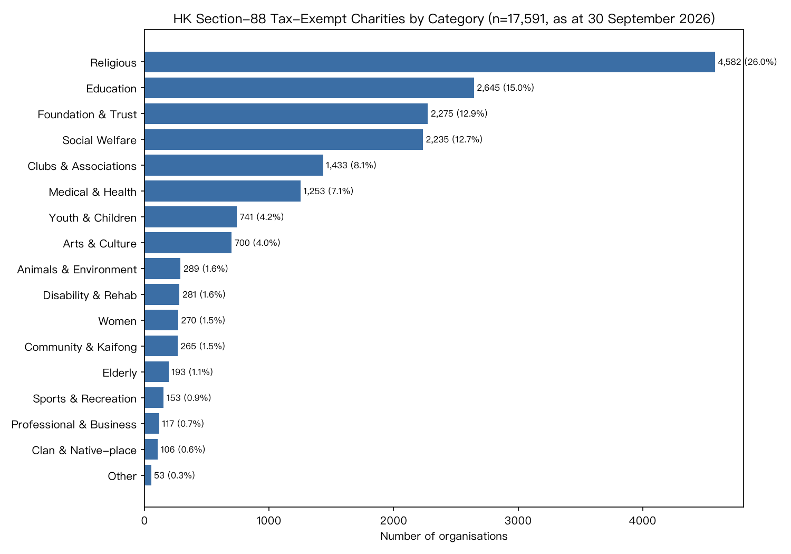

# Hong Kong Section-88 Tax-Exempt Charities — Categorisation

**Source:** IRD `s88list.csv` · **As at:** 30 September 2026 · **Total organisations:** 17,591

**Method:** hybrid classifier — deterministic bilingual keyword matching for confident
single-match names, with `qwen/qwen3.7-plus` (via OpenRouter) as the LLM tie-breaker for
ambiguous (multi-keyword) and unmatched names.

| # | Category | Count | % | Examples |
|---|---|---:|---:|---|
| 1 | Religious 宗教 | 4,582 | 26.0% | 小西灣南海觀音廟管理委員會 · 天教六壬良園舘有限公司 · 圓通精舍有限公司 |
| 2 | Education 教育 | 2,645 | 15.0% | 「向山舉目」助學金會 · 大埔泮涌社區教育中心有限公司 · 慈靄教育文化協會有限公司 |
| 3 | Foundation & Trust 基金信託 | 2,275 | 12.9% | 中華彌勒文化慈善基金會有限公司 · 正念‧慈愛慈善基金有限公司 · 張永漢慈善基金有限公司 |
| 4 | Social Welfare & Services 社會福利服務 | 2,235 | 12.7% | 植皂坊義工隊 · 樂助同行 · 潤愛同行有限公司 |
| 5 | Clubs & Associations 會社協會 | 1,433 | 8.1% | 友情有善協會 · 希望之橋協會 · 愛協會 |
| 6 | Medical & Health 醫療衞生 | 1,253 | 7.1% | 健康行動有限公司 · 樂信兒童醫療及教育基金有限公司 · 先進生物醫學儀器中心有限公司 |
| 7 | Youth & Children 青少年兒童 | 741 | 4.2% | 卓信英才有限公司 · "F. O. C. U. S." (Focus  · 昇普計劃 |
| 8 | Arts & Culture 文化藝術 | 700 | 4.0% | 冰菓藝文有限公司 · 曲藝草蘆 · 香港振興京劇票房有限公司 |
| 9 | Animals & Environment 動物環保 | 289 | 1.6% | 綠色環保互動委員會有限公司 · 有尾無尾拯救隊有限公司 · 動物護航協會有限公司 |
| 10 | Disability & Rehab 復康傷健 | 281 | 1.6% | 愛加倍國際愛聾協會有限公司 · 香港精神復元者聯盟 · 基督教漸凍人關愛協會有限公司 |
| 11 | Women 婦女 | 270 | 1.5% | 港區婦聯代表聯誼會基金有限公司 · American Women's Associa · 亞洲婦女協進會有限公司 |
| 12 | Community & Kaifong 社區街坊 | 265 | 1.5% | 石湖新村(河北段)街坊會 · 香港中西區關愛服務及社區發展基金有限公司 · 恒有餘力互助會 |
| 13 | Elderly 長者 | 193 | 1.1% | 香港老戰士之家 · 耆英堂香港服務社 · 愛耆慈善社有限公司 |
| 14 | Sports & Recreation 體育康樂 | 153 | 0.9% | 羽毛愛心伸展 · 耆樂運動會 · 樂陽體育協會 |
| 15 | Professional & Business 專業商會 | 117 | 0.7% | 禁毒專業聯盟有限公司 · 國際人才組織聯合會有限公司 · 香港中文大學外科醫生協會有限公司 |
| 16 | Clan & Native-place 宗親同鄉 | 106 | 0.6% | 八仁社 · 香港鍾氏宗親慈善基金有限公司 · 觀塘潮僑工商界盂蘭勝會慈善基金有限公司 |
| 17 | Other / Uncategorised 其他 | 53 | 0.3% | 1A Group Limited · (香港仔有限公司) · (香港仔有限公司) |

**Outputs:** `s88list_categorised.csv` (per-org labels), `category_counts.json`, `s88_categories.png`