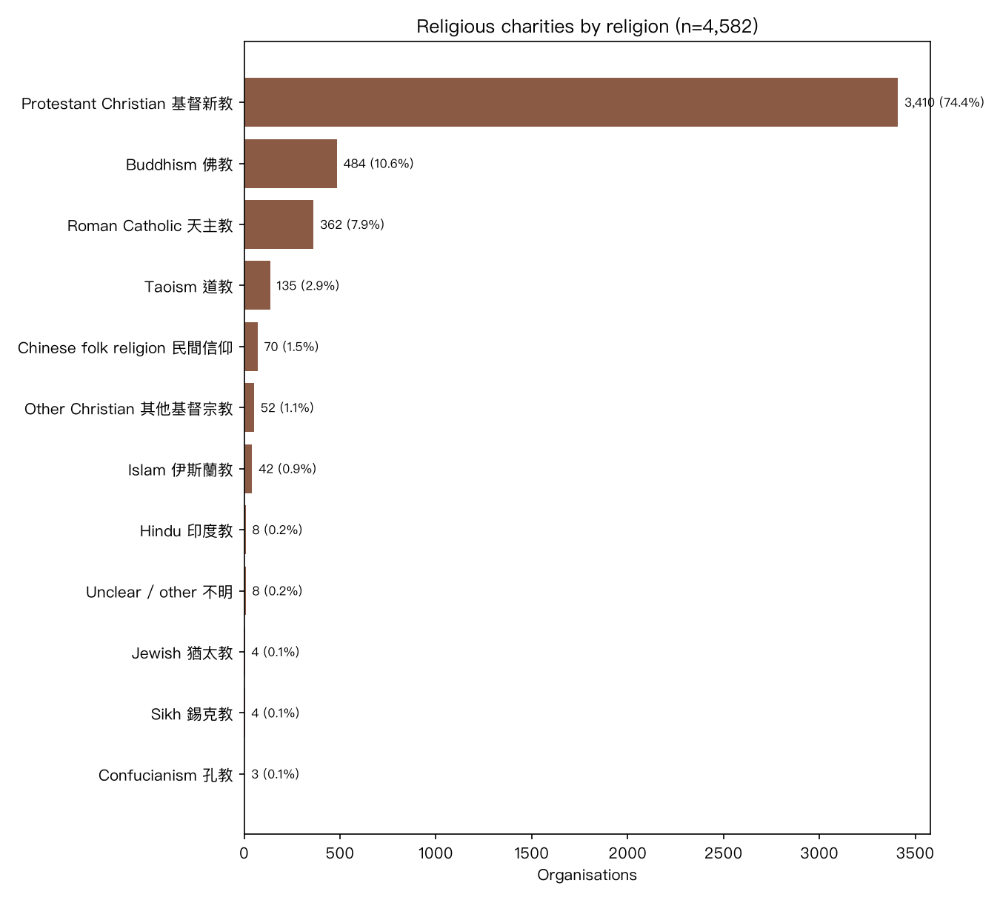
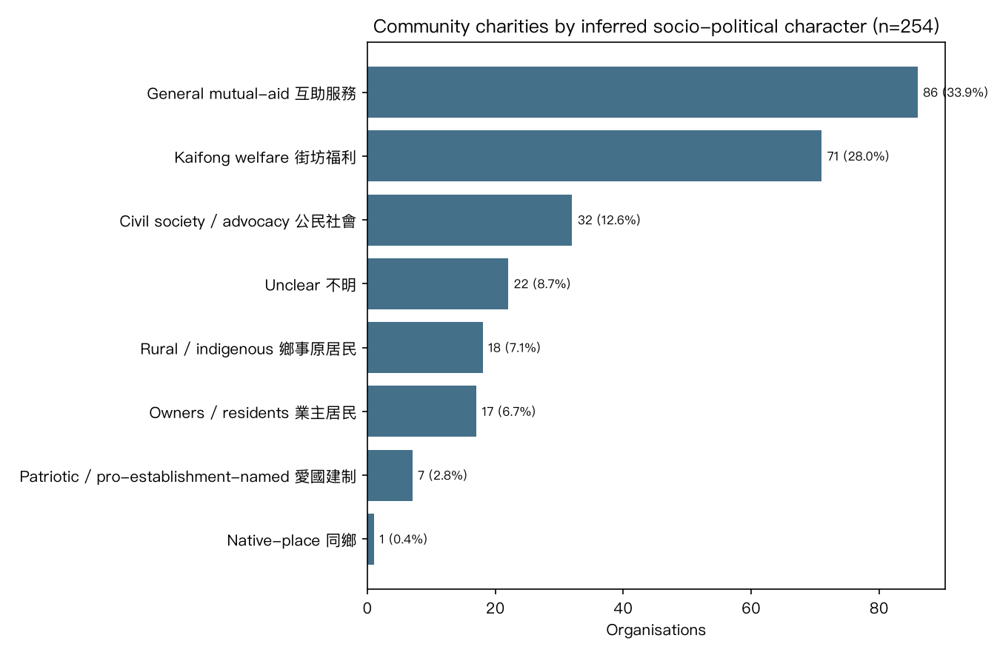

# HK Section-88 Charities — Religious & Community Sub-Breakdowns

*LLM sub-classification via `qwen/qwen3.7-plus`. Religion/denomination and socio-political
character are **inferred from organisation names** and are indicative, not authoritative.*

## Religious groups by religion

| Category | Count | % | Examples |
|---|---:|---:|---|
| Protestant Christian 基督新教 | 3,410 | 74.4% | 基督教418路社區教會有限公司 · 611靈糧堂有限公司 · 611靈糧堂有限公司 |
| Buddhism 佛教 | 484 | 10.6% | 圓通精舍有限公司 · 中國佛教學會有限公司 · 香港淨宗學會有限公司 |
| Roman Catholic 天主教 | 362 | 7.9% | Abbot in Hong Kong of  · Abbot in Hong Kong of  · Apostolic Catholic Chu |
| Taoism 道教 | 135 | 2.9% | 天教六壬良園舘有限公司 · 至和壇有限公司 · 正德道德堂有限公司 |
| Chinese folk religion 民間信仰 | 70 | 1.5% | 小西灣南海觀音廟管理委員會 · 香港仔譚公爺廟有限公司 · 福德老爺古廟有限公司 |
| Other Christian 其他基督宗教 | 52 | 1.1% | 耶穌基督後期聖徒教會香港有限公司 · 耶穌基督後期聖徒教會香港有限公司 · 耶穌基督後期聖徒教會香港有限公司 |
| Islam 伊斯蘭教 | 42 | 0.9% | Ahmadiyya Muslim Jamat · (中華回教博愛社) · (中華回教博愛社) |
| Hindu 印度教 | 8 | 0.2% | Bhaktivedanta Books Li · Bochasanwasi Shri Aksh · Hindu Swayamsevak Sang |
| Unclear / other 不明 | 8 | 0.2% | Incorporated Trustees  · 香港新興教派研究中心有限公司 · 香港神慈秀明會有限公司 |
| Jewish 猶太教 | 4 | 0.1% | Chabad Lubavitch Jewis · Kehilat Zion Synagogue · United Israel Appeal ( |
| Sikh 錫克教 | 4 | 0.1% | Khalsa Diwan, Hong Kon · Khalsa Diwan, Hong Kon · Singh Sabha (H.K) Limi |
| Confucianism 孔教 | 3 | 0.1% | 孔教學院 · (香港孔聖堂有限公司) · (香港孔聖堂有限公司) |

### Protestant denominations

| Denomination | Count |
|---|---:|
| Independent | 1,111 |
| Lutheran | 451 |
| Evangelical | 367 |
| Baptist | 352 |
| Alliance | 340 |
| Pentecostal | 239 |
| Methodist | 151 |
| Salvation-Army | 151 |
| Anglican | 134 |
| Presbyterian | 50 |
| Adventist | 39 |
| Brethren | 23 |
| - | 2 |

## Community groups by inferred socio-political character

| Category | Count | % | Examples |
|---|---:|---:|---|
| General mutual-aid 互助服務 | 86 | 33.9% | 恒有餘力互助會 · 堅離地同樂會慈善基金有限公司 · 同社 |
| Kaifong welfare 街坊福利 | 71 | 28.0% | 石湖新村(河北段)街坊會 · 香港仔街坊福利會有限公司 · 香港仔街坊福利會有限公司 |
| Civil society / advocacy 公民社會 | 32 | 12.6% | 香港中西區關愛服務及社區發展基金有限公司 · 全港社區發展連線有限公司 · 社區盟有限公司 |
| Unclear 不明 | 22 | 8.7% | 安迪潘瑜伽聯盟有限公司 · 大銀力量有限公司 · 香村創意有限公司 |
| Rural / indigenous 鄉事原居民 | 18 | 7.1% | 長洲鄉事委員會 · 厦村鄉鄉事委員會 · 養和山村義工隊有限公司 |
| Owners / residents 業主居民 | 17 | 6.7% | 彩牛居民力量 · 晴雲樓互助委員會 · 東九龍居民委員會有限公司 |
| Patriotic / pro-establishment-named 愛國建制 | 7 | 2.8% | 建設健康九龍城協會有限公司 · 富泰同心協會 · 香港南區各界聯會有限公司 |
| Native-place 同鄉 | 1 | 0.4% | 香港仔田灣邨華富邨華貴邨潮僑坊眾盂蘭勝會有限 |

> **Caveat:** affiliation is inferred from naming patterns (e.g. 鄉事委員會 → rural-indigenous,
> 街坊福利會 → kaifong-grassroots, 各界聯會/社團聯會 → pro-establishment umbrella). It is a lean for
> the group as a *type*, not a verified political stance of any individual organisation.

**Outputs:** `sub_religion.csv`, `sub_community.csv`, `s88_religion.png`, `s88_community.png`